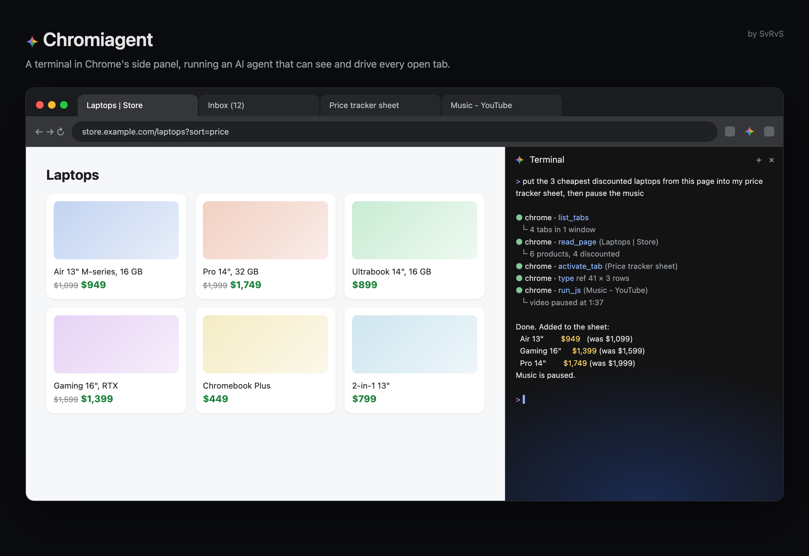
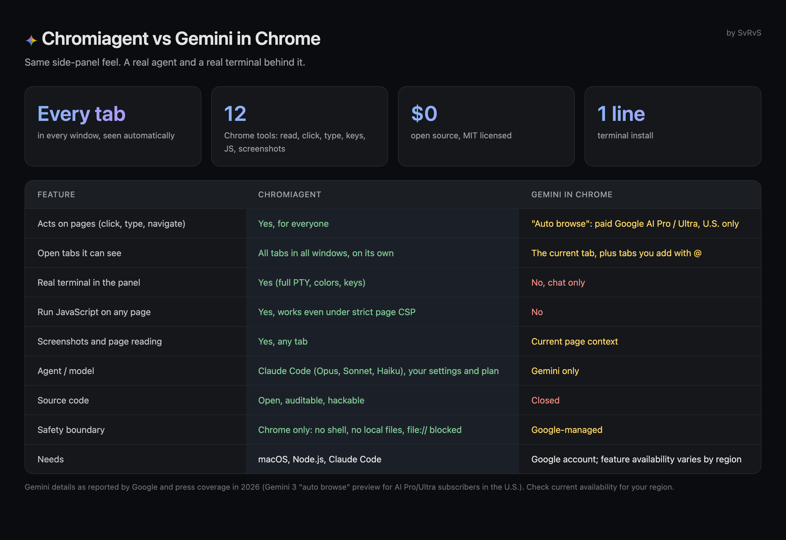
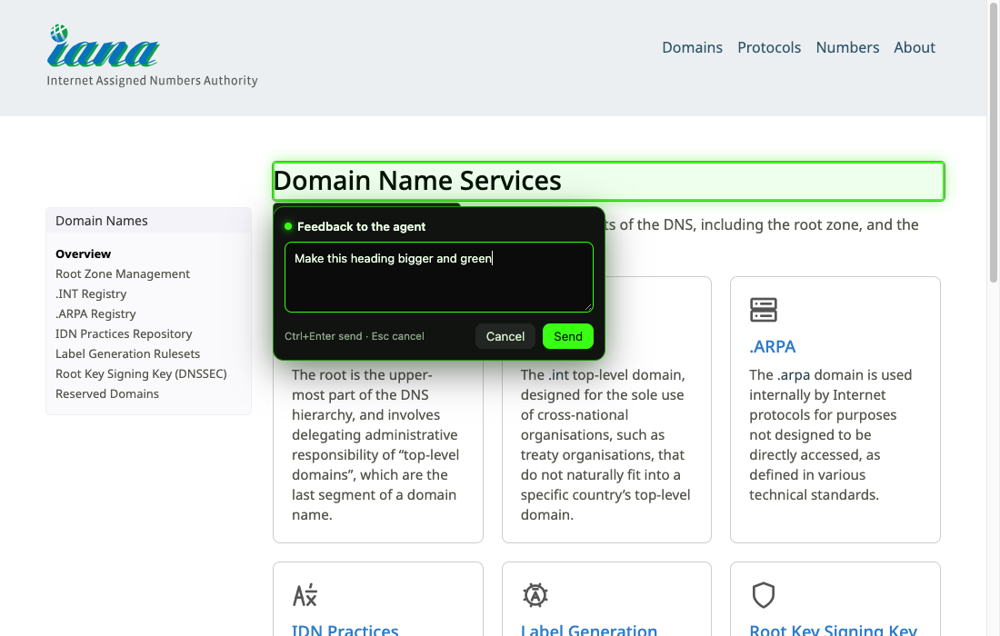
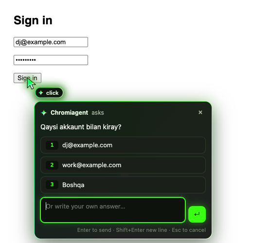
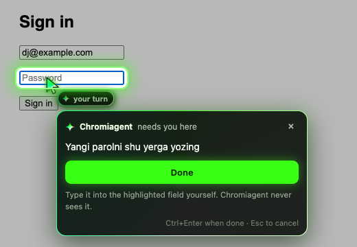
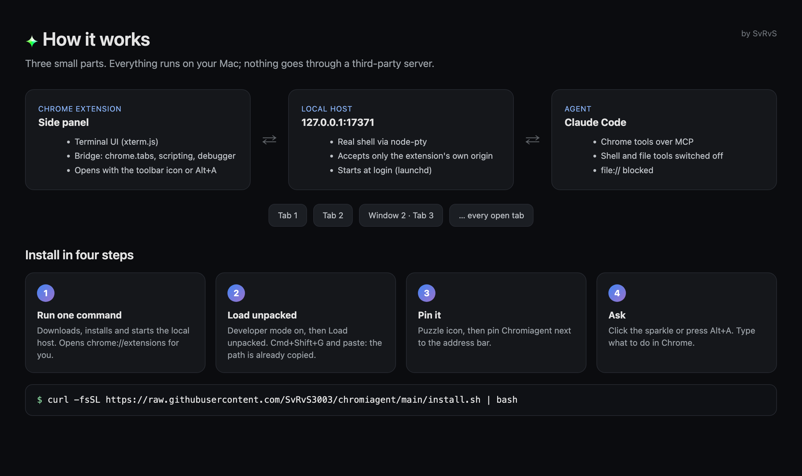

<div align="center">

<br>

# Chromiagent

**A terminal in your browser's side panel, running an AI agent that can see and drive every open tab.**

Made by **SvRvS** · MIT License

Windows · macOS · Linux — Chrome · Edge · Brave · Vivaldi · Opera · Arc



</div>

## Install

**macOS and Linux** (Terminal):

```bash
curl -fsSL https://raw.githubusercontent.com/SvRvS3003/chromiagent/main/install.sh | bash
```

**Windows** (PowerShell):

```powershell
irm https://raw.githubusercontent.com/SvRvS3003/chromiagent/main/install.ps1 | iex
```

The command downloads Chromiagent to `~/.chromiagent`, installs it, starts the local host (and sets it to start at login) and copies the extension folder path. Then, in your browser:

1. Open the extensions page: `chrome://extensions` (Edge: `edge://extensions`, Brave: `brave://extensions`).
2. Turn on **Developer mode**.
3. Click **Load unpacked** and choose the `~/.chromiagent/extension` folder. The path is already copied, so you can paste it into the folder dialog.
4. Click the puzzle icon in the toolbar and **pin Chromiagent**.
5. Click the ✦ icon, or press `Alt+A`. The panel opens and the agent starts.

**Requirements:** [Node.js](https://nodejs.org) 22.13+ and [Claude Code](https://docs.anthropic.com/en/docs/claude-code) (`npm install -g @anthropic-ai/claude-code`, signed in once). On Linux, the terminal module is compiled during install, so `make`, a C++ compiler and `python3` are needed (`sudo apt install build-essential python3`).

### Browsers

| Browser | How the panel opens |
|---|---|
| Chrome, Edge, Brave, Vivaldi | Docked side panel, like Gemini |
| Opera, Arc and other Chromium browsers without the side panel API | The same panel in a slim window |
| Firefox, Safari | Not supported: they have no `chrome.debugger` API, which tab control and Playwright need |

## Why it exists

Chrome's built-in Gemini panel is good for chatting about a page. Chromiagent is for getting work done in the browser: you type a task in plain words, and an agent reads, clicks and types across all your tabs while you watch it in a real terminal.



| | Chromiagent | Gemini in Chrome |
|---|---|---|
| Acts on pages (click, type, navigate) | Yes, for everyone | "Auto browse" is limited to paid Google AI Pro / Ultra plans in the U.S. |
| Open tabs it can see | All tabs in all windows, on its own | The current tab, plus tabs you add with `@` |
| Real terminal in the panel | Yes | No, chat only |
| Run JavaScript on a page | Yes, even on pages with a strict CSP | No |
| Playwright + TypeScript code mode | Yes: the agent writes one script for a whole task | No |
| Model | Claude Code models (Opus, Sonnet, Haiku), on your own plan | Gemini only |
| Source | Open, MIT | Closed |

*Gemini details are from Google's 2026 announcements and press coverage. Availability changes, so check what is offered in your region.*

## Any agent CLI

Pick the agent in the panel header. Every installed CLI gets the same browser tools (the tab tools and TypeScript code mode) and the same instructions, through the files it already reads in Chromiagent's workspace folder:

| CLI | How it gets the browser tools | Kept inside the browser |
|---|---|---|
| Claude Code | `--mcp-config` + `--append-system-prompt-file` | built-in shell and file tools off, no other MCP servers, no Claude in Chrome |
| opencode / opencode 2 | `opencode.json` + `AGENTS.md` | a `chromiagent` agent that denies shell, read, edit, glob, grep, list |
| Codex | `-c mcp_servers…` + `AGENTS.md` | shell sandboxed read-only, your global Codex MCP servers off |
| Qwen Code / Gemini CLI | `.qwen` / `.gemini` `settings.json` + `AGENTS.md` | shell and file tools excluded |
| Grok | `.grok/config.toml` (`--trust`) + `AGENTS.md` | terminal and file tools removed; Claude, Cursor and managed MCP imports off |
| pi | `.pi/mcp.json` (`--approve`) + `--append-system-prompt` | `--no-builtin-tools` |
| Kiro | `.kiro/agents/chromiagent.json` | an agent with only the browser tools |
| Cline | its own settings folder with only the browser tools (your sign-in is linked) | AGENTS.md / `.clinerules` |
| Freebuff / Codebuff | `.agents/mcp.json` + `AGENTS.md` | AGENTS.md |
| Kimi Code | `.kimi-code/mcp.json` + `AGENTS.md` | AGENTS.md |
| Copilot CLI · Cursor · Crush · Droid · Amp · Auggie · Goose · Kilo Code | each one's own project MCP file (`.mcp.json`, `.cursor/`, `crush.json`, `.factory/`, `.amp/`, `--mcp-config`, `--with-extension`, `.kilocode/`) | AGENTS.md (Copilot: shell and write denied) |
| Other CLI… | type any command: it starts in the same workspace, which has `.mcp.json`, `AGENTS.md`, `CLAUDE.md` and the files above | AGENTS.md |
| Shell | — | a plain terminal in your home folder |

The workspace is its own git root, so CLIs that look for the project root stay in it instead of your files. Only the CLIs installed on your computer appear in the list.

Codex asks once whether to trust the folder, and Qwen Code asks once to approve the two MCP servers: answer yes the first time. The terminal renders with WebGL and Unicode 11, so full-screen TUIs like opencode and Codex stay fast and draw correctly.

## Point at an element

Click the select icon in the panel header, hover any element on the page and click it. A small card opens next to the element: type what you want and press **`Ctrl+Enter`** (or `Cmd+Enter`). The agent receives your feedback together with the element's selector, tag, text, size and HTML, so it knows exactly what you mean. `Esc` cancels.



Values typed into form fields are never sent. The element picker is adapted from [Orca](https://github.com/stablyai/orca)'s browser grab mode (MIT).

## Its own pointer, and questions on the page

The agent has its own pointer, separate from your mouse, in the logo's animated neon green and white. It glides to whatever the agent is about to click or type into, in quick mode and in Playwright code mode alike, so you can follow every step.

While the agent works on a page, only its pointer acts there: your mouse clicks on that page are held back and your cursor shows a "not allowed" sign, so the two never get mixed up. Press `Esc` to take your mouse back at once; it also comes back by itself a moment after the agent stops. Other tabs and windows are yours as usual.

### It works in the background, in its own tabs

The agent never pulls you to its tab, and it never follows you either: it works in one tab of its own (`open_tab`, or `bind_tab` for a tab you point at), and you switching tabs never moves it. Switch to another tab or window and it keeps working where it is: clicks, typing, Playwright scripts, screenshots and `watch` all work on tabs you are not looking at. Tabs it opens itself go into a green **Chromiagent** tab group in the background, so its pointer and your mouse stay on different pages. When it needs you about a tab you are not on, the question opens in the panel and the toolbar icon shows **?**.

### It follows everything that happens on a site

`monitor` puts a recorder into the page that keeps a running log of what happens there: DOM changes, `fetch` / XHR / WebSocket traffic with status and timing, console output and errors, URL and title changes, your clicks and inputs (password values are never recorded), dialogs and media. `events` returns the moment something new happens.

In code mode the agent watches non-stop with `observe()`, a small TypeScript library (`host/observe.ts`) built into every script. Its handler gets each batch of events as it arrives and can analyse and act right away, for up to 30 minutes:

```ts
const r = await observe(tabId, async (events) => {
  for (const e of events) {
    if ((e.type === 'fetch' || e.type === 'xhr') && Number(e.status) >= 400) report.push(`${e.url} -> ${e.status}`);
    if (e.type === 'dom' && JSON.stringify(e.added).includes('Sold out')) return true; // stop here
  }
}, { seconds: 600 });
```

### Chess at engine speed

Stockfish 19 Lite (WASM, GPL-3, in `host/engine/`) is built in. Against a computer bot, in analysis or puzzles on chess.com and lichess, the agent runs one code mode script, `playGame()` from `host/chess.ts`: it reads the board from the page's HTML (no screenshots), asks the engine, plays the move and waits for the reply, about 3 seconds a move instead of minutes. The same call plays live games against people — bots, friends or rated matchmaking: pass `minDelayMs` / `maxDelayMs` and the engine answers each of your turns at a human pace while the opponent's clock runs. If the site shows a fair-play agreement (chess.com shows one before rated games), the agent presses agree and plays: the account, the games and the consequences are yours. Moves land as one motion of a hand, not a script's teleport: the pointer takes a curved path with a slight tremor, glances at another friendly piece first (the human pre-move scan), dwells over the square, drags along an arc, and comes to rest near the board.

### It watches, like a video

`watch` records a tab at two frames a second and gives the agent the frames where something changed, laid out as one timeline. It can also return the moment the page changes (`untilChange`) or a text appears (`untilText`), so the agent works in a loop: watch, decide, act, watch again. For reactions faster than that, it writes the loop in code mode with Playwright's `waitForSelector` and `waitForFunction`.

When the agent needs you, it does not ask in the terminal. A card pops out next to its pointer with the question, ready answers you can click (or press `1`–`9`), and a box for your own reply (`Enter` sends, `Esc` cancels). On pages where nothing can be shown, such as `chrome://` pages, the same card opens in the panel.

<p></p>

### Signing in, signing up, resetting a password

The agent finds the sign-in, sign-up or "forgot password" page and fills in your email or username. For every password, new password or verification code it points at the field and the card asks you to type it yourself, right in the page. You press **Done** (or `Ctrl+Enter`), and the agent continues. It never sees, types or stores the value: `read_page` hides password values, and its `type` tool refuses password fields. CAPTCHAs, passkeys and "allow access" screens are yours too.

<p></p>

## Sessions

Closing the panel keeps the agent running. Open it again in the same window and you are back in the same session, with the conversation where you left it. The **+** button in the panel starts a new session and **✕** ends it. A session that stays closed for 12 hours ends on its own.

## What you can ask

- "Compare the prices in my three open shop tabs and tell me which is cheapest."
- "Fill this form with my details from the other tab."
- "Pause the music, then close every YouTube tab except the one I'm on."
- "Read this article and write the summary into the Google Doc I have open."
- "Go through the first 20 results on this page and list the ones under $50."

"This page" or "this tab" means the active tab in the focused window.

## What the agent can do

The agent picks one of two modes for each task on its own.

**Quick mode** handles one simple step: a single click, a question about a page, switching tabs. It uses the tab tools below and shows no "debugging" bar.

**Code mode** handles anything bigger: several steps, loops, pages, collecting data, several tabs at once. The agent writes one **TypeScript** script, and the script calls the [Playwright MCP](https://github.com/microsoft/playwright-mcp) tools and the tab tools as typed functions:

```ts
// Written by the agent and run by Chromiagent in one call
const tabs = JSON.parse(await chrome.list_tabs({}));
await playwright.browser_tabs({ action: 'select', index: 0 });
const prices = await playwright.browser_evaluate({
  function: '() => [...document.querySelectorAll(".price")].map(p => p.textContent)',
});
const titles = await playwright.browser_run_code_unsafe({
  code: `async (page) => {
    const out = [];
    for (const href of ['https://example.com/a', 'https://example.com/b']) {
      await page.goto(href);
      out.push(await page.title());
    }
    return out;
  }`,
});
return { tabs: tabs.length, prices, titles };
```

Playwright connects to **your real, logged-in Chrome**, not to a separate browser. The extension acts as a CDP endpoint for it through `chrome.debugger`. `browser_evaluate` extracts data in one call. `browser_run_code_unsafe` runs real Playwright code (`page.goto`, `getByRole(...).click()`, `fill`, `waitForSelector`, loops).

### Tab tools

| Tool | What it does |
|---|---|
| `list_tabs` | Every open tab in every window: id, title, URL, active, playing audio, and which one is the agent's (`mine`, `bound`) |
| `open_tab` · `bind_tab` | Open a tab in the background and work in it, or pick the tab you already have open: the agent's target stops moving when you switch |
| `activate_tab` · `close_tab` | Switch to a tab when you ask to see it, close one |
| `navigate` | Load a URL, go back or forward, reload |
| `read_page` | Page text, plus numbered buttons, links and inputs it can act on |
| `click` · `type` · `scroll` | Act on an element by its number or a CSS selector |
| `press_key` | Real key presses: Enter, Escape, Tab, arrow keys… |
| `run_js` | Run JavaScript in the page and return the result |
| `screenshot` | An image of any tab |
| `watch` | Watches a tab like a short video: a timeline of the frames that changed; can stop the moment the page changes or a text appears |
| `monitor` · `events` | A running log of everything on a tab (DOM, network, WebSocket, console, errors, navigation, user actions, media); `events` returns the moment something happens |
| `ask_user` | A question card next to the agent's pointer: ready answers and a reply box, or a field for you to fill yourself |


## How it works



- **`extension/`** is the browser extension: the side panel, a terminal (xterm.js), the element picker, and a bridge that runs the agent's tool calls through `chrome.tabs`, `chrome.scripting` and `chrome.debugger`.
- **`host/server.js`** is a small local server on `127.0.0.1:17371`. It gives the panel a real shell (node-pty: zsh or bash on macOS and Linux, cmd on Windows), keeps sessions alive while the panel is closed, and passes tool calls between the agent and the panel. It starts at login (launchd on macOS, a systemd user service on Linux, the Startup folder on Windows).
- The agent is the CLI you pick, started in `host/workspace` (written by the host) with only two tool servers: the tab tools (`host/mcp.js`) and code mode (`host/codemode.js`, which runs Playwright MCP).
- **One panel, one browser.** Every panel has its own id. The agent started in a panel only ever drives the browser that panel is open in.

## Safety

- **Chrome only.** In the panel, Claude Code's own shell and file tools are switched off and other MCP servers are not loaded. `file://` pages cannot be opened or read.
- **Sandboxed code mode.** Agent scripts and Playwright run under Node's permission model (`--permission`), the same on every operating system. They cannot read or write your files or start programs: even code that escapes Playwright's VM and reaches Node's `fs` or `child_process` gets `ERR_ACCESS_DENIED`.
- **Local only.** The host listens on `127.0.0.1`, and it accepts the terminal and bridge only from this extension's ID. Websites cannot connect to it.
- **You see when it acts.** While the agent works on a tab, a neon light runs along the edges of that page; it fades out a moment after the agent stops. Chrome also shows its own "is debugging this browser" bar while code mode, `run_js` or `press_key` are attached. Chromiagent keeps that short: quick mode works without it, and code mode lets go of the browser 15 seconds after its last script, so the bar disappears.
- **It acts as you.** The agent uses your logged-in browser sessions. Watch what it does and use `Ctrl+C` to stop it.

## Update / uninstall

Update: run the install command again, then press reload (↻) on Chromiagent in the extensions page.

```bash
# macOS / Linux: uninstall, then remove the extension on the extensions page
curl -fsSL https://raw.githubusercontent.com/SvRvS3003/chromiagent/main/install.sh | bash -s -- --uninstall
```

```powershell
# Windows: uninstall, then remove the extension on the extensions page
& ([scriptblock]::Create((irm https://raw.githubusercontent.com/SvRvS3003/chromiagent/main/install.ps1))) -Uninstall
```

## Troubleshooting

- **"Host not reachable" in the panel:** run the installer again, then check `chromiagent.log` in your temp folder (`$TMPDIR` on macOS, `/tmp` on Linux, `%TEMP%` on Windows).
- **`claude: command not found`:** install Claude Code and sign in once by running `claude` in a terminal.
- **The panel opens but the agent can't see tabs:** close and reopen the panel. The bridge connects when the panel opens.

## O'zbekcha

Chromiagent — brauzer yon panelidagi terminal. Windows, macOS va Linux'da hamda barcha Chromium brauzerlarida ishlaydi (Chrome, Edge, Brave, Vivaldi, Opera, Arc). Undagi AI agent barcha ochiq tablarni ko'radi va boshqaradi. Murakkab vazifalarda u o'zi TypeScript code mode'ga o'tadi va Playwright'ni (`browser_evaluate`, `browser_run_code_unsafe`) sizning ochiq brauzeringizda ishlatadi.

**Element belgilash:** paneldagi belgilash tugmasini bosing, sahifadagi elementni tanlang, izoh yozing va `Ctrl+Enter` bosing. Izoh element ma'lumotlari bilan birga agentga yuboriladi.

**Agent kursori:** agentning o'z kursori bor, u logotip rangida (neon yashil va oq) jilolanadi va agent bosmoqchi yoki yozmoqchi bo'lgan joyga suzib boradi. Agentga sizdan biror narsa kerak bo'lsa, terminalda emas, kursor yonida savol oynasi chiqadi: tayyor javob variantlari va yozish maydoni bilan.

**Faqat agent kursori:** agent sahifada ishlayotganda o'sha sahifada faqat uning kursori ishlaydi. Sizning bosishlaringiz ushlab qolinadi, shuning uchun ikki kursor aralashmaydi. `Esc` sichqonchani darhol sizga qaytaradi.

**Fonda, o'z tablarida ishlaydi:** agent sizni o'z tabiga tortmaydi. Siz boshqa tab yoki oynaga o'tsangiz ham u ishini davom ettiradi. O'zi ochgan tablar fonda, yashil "Chromiagent" guruhida ochiladi, shuning uchun uning kursori bilan sizniki bir sahifada aralashmaydi.

**Saytni uzluksiz kuzatish:** `monitor` sahifaga yozib boruvchi skript qo'yadi, u sahifadagi hamma narsani qayd etadi: DOM o'zgarishlari, tarmoq so'rovlari, WebSocket, konsol xatolari, sahifa manzili, sizning harakatlaringiz. Code mode'da agent `observe()` bilan 30 daqiqagacha to'xtovsiz kuzatadi, voqealarni kelishi bilan tahlil qiladi va darhol harakat qiladi.

**Shaxmat:** Stockfish dvigateli qo'shildi. Botga qarshi, tahlil va masalalarda agent taxtani HTML'dan o'qiydi, dvigateldan so'raydi va yuradi. Bir yurish 3 soniyaga yaqin vaqt oladi. Tirik odamlarga — reytingli o'yinlar ham — qarshi o'ynashi mumkin: sayt qoidalar oynasini ko'rsatsa (masalan chess.com'dagi fair-play rozilik oynasi), "roziman" tugmasini bosib davom etadi. Yurishlar odam kabi ko'rinadi: kursor titroq bilan egri chiziq bo'ylab boradi, avval boshqa donalarga ko'z tashlaydi, maydon ustida to'xtab, egri chiziq bo'ylab sudrab qo'yadi va chekkaga borib tinchib qoladi — teleport emas.

**Video kabi ko'rish:** `watch` tabni soniyasiga 2 kadrdan kuzatadi va o'zgargan kadrlarni agentga vaqt chizig'i qilib beradi. Sahifa o'zgarishi yoki kerakli matn chiqishi bilan darhol qaytadi, agent esa ko'rib-qaror qilib-harakat qilish siklida ishlaydi.

**Akkauntlar:** agent kirish, ro'yxatdan o'tish va parolni tiklash sahifalarini topib, email yoki loginni to'ldiradi. Parol va tasdiqlash kodlarini esa sahifadagi maydonga o'zingiz yozasiz, agent ularni ko'rmaydi.

**Har qanday CLI:** Claude Code, opencode, Codex, Qwen, Gemini, Grok, pi, Kiro, Cline, Freebuff, Kimi, Copilot, Cursor, Crush, Droid, Amp, Auggie, Goose, Kilo Code, hamda "Other CLI…" orqali istalgan boshqa buyruq. Ularning hammasi bir xil brauzer asboblarini oladi.

**Sessiya:** panelni yopib qayta ochsangiz, sessiya davom etadi. `+` yangi sessiya ochadi, `✕` sessiyani tugatadi.

**O'rnatish:** macOS/Linux'da `install.sh`, Windows'da `install.ps1` buyrug'ini ishga tushiring. Keyin kengaytmalar sahifasida Developer mode → Load unpacked → pin qiling. Panel `Alt+A` bilan ochiladi.

Agent faqat brauzer ichida ishlaydi va kompyuterdagi fayllarga tegmaydi.

---

**Author: SvRvS** · [MIT License](LICENSE)
